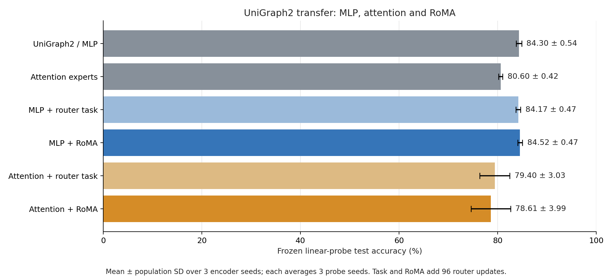
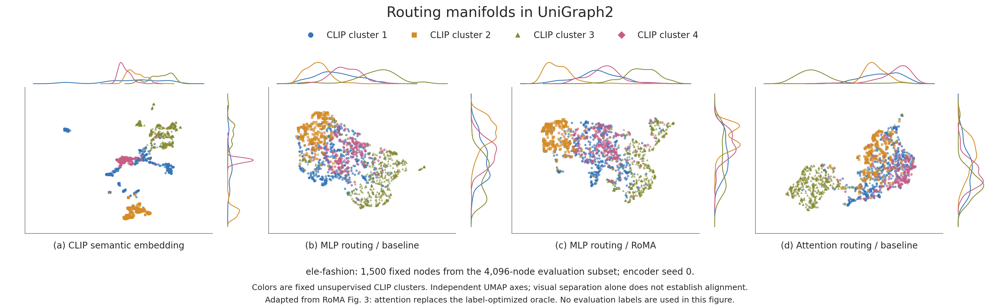

# UniGraph2, attention and RoMA comparison

Completed real-data transfer experiment. Mean ± population standard deviation across encoder seeds, each averaged over probe seeds.

| Condition | Test accuracy (%) | Encoder-seed means (%) | Slurm jobs |
| --- | ---: | --- | --- |
| UniGraph2 / MLP | 84.30 ± 0.54 | 83.77, 84.10, 85.05 | 84360, 84361, 84359 |
| Attention experts | 80.60 ± 0.42 | 80.84, 80.95, 80.00 | 84360, 84361, 84359 |
| MLP + router task | 84.17 ± 0.47 | 83.74, 83.93, 84.83 | 84360, 84361, 84359 |
| MLP + RoMA | 84.52 ± 0.47 | 84.18, 84.18, 85.19 | 84360, 84361, 84359 |
| Attention + router task | 79.40 ± 3.03 | 81.34, 81.73, 75.12 | 84360, 84361, 84359 |
| Attention + RoMA | 78.61 ± 3.99 | 81.26, 81.59, 72.97 | 84360, 84361, 84359 |

The fourth panel compares the earlier attention expert method. No label-optimized oracle is constructed. Four semantic groups are inferred once from raw CLIP features, and every panel uses the same nodes and group assignments. UMAP layouts are independently fit with fixed settings; their apparent geometry is not a quantitative alignment test.

## Adaptation and controls

[RoMA](https://arxiv.org/html/2511.07419v2) fine-tunes routers against successful semantic neighbors with experts frozen (Eqs. 5–10). This graph adaptation uses normalized frozen CLIP features, Gaussian kNN weights, and fixed unmasked teacher routes. Success means the lowest half of mean masked reconstruction errors within each pre-training domain, rather than correct labeled answers. This surrogate is an experimental design choice.

All conditions use 5 passes × 32 Amazon-Cloth subgraphs, lr 0.0001, warmup 0.1, standardization True, width 1024, 8 experts, and top-k 0 (zero means dense). Evaluation uses the first 4096 Ele-Fashion nodes and original intersected splits. Encoder seeds: [0, 1, 2]; probe seeds: [0, 1, 2].

Task-only and RoMA each add 3 × 32 gate-only updates at lr 7e-05, branching from the identical pretrained checkpoint within each expert/seed. Frozen modules run with dropout disabled. RoMA uses λ=0.8, k=5, σ=0.4; λ warms up with the learning rate. Defaults were fixed before examining results; no test-based selection was performed.

## Paired effect of manifold regularization

- MLP: RoMA − task-only = +0.353 ± 0.080 percentage points across matched encoder seeds.
- ATTENTION: RoMA − task-only = -0.790 ± 0.960 percentage points across matched encoder seeds.

## Original-space routing diagnostics

These diagnostics use the 1500 plotted nodes from encoder seed 0. kNN overlap@15 compares raw-CLIP semantic neighbors with routing neighbors before UMAP. Chance is approximately 15/(N−1); higher overlap alone does not prove better task performance.

| Routing | CLIP kNN overlap@15 | CLIP-cluster silhouette | Mean expert probability SD | Effective rank |
| --- | ---: | ---: | ---: | ---: |
| mlp-none | 0.1797 | 0.0795 | 0.02642 | 6.18 |
| attention-none | 0.1800 | 0.1128 | 0.02722 | 5.80 |
| mlp-task | 0.2207 | 0.2075 | 0.04311 | 3.75 |
| mlp-roma | 0.1861 | 0.0634 | 0.02409 | 5.99 |
| attention-task | 0.1868 | 0.1188 | 0.03522 | 4.36 |
| attention-roma | 0.1845 | 0.1148 | 0.02453 | 5.44 |

## Limits and evidence

This is a bounded transfer experiment using one source domain and a target subset. It does not reproduce either paper's full benchmark. Three encoder seeds measure observed spread, not a confidence interval or a significance test. Additional router optimization is controlled by the task-only branches; baseline and attention results have fewer total optimizer steps.

Per-probe validation/test scores, selected epochs and job IDs: [scores.csv](scores.csv). Complete results and provenance: [comparison.json](comparison.json). Plotted coordinates, raw routing weights and node IDs: [manifold-data.npz](figures/manifold-data.npz). Plot settings and original-space metrics: [visualization.json](figures/visualization.json). All routing conditions: [routing-controls.png](figures/routing-controls.png). Vector exports are beside each PNG.
