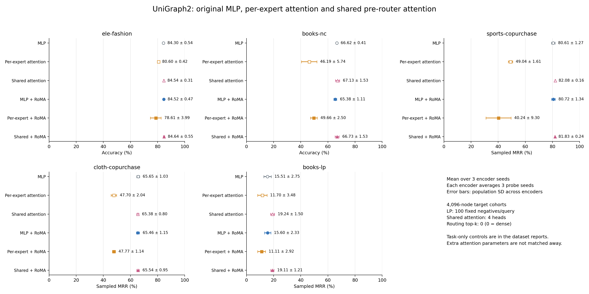

# Shared pre-router attention: five-dataset comparison

All 135 runs completed. Values are mean ± population standard deviation over 3 encoder seeds, each averaging 3 probe seeds.

| Target | Metric (%) | Original MLP | Old per-expert attention | New shared attention + MLP |
| --- | --- | ---: | ---: | ---: |
| [ele-fashion](ele-fashion/COMPARISON.md) | accuracy | 84.30 ± 0.54 | 80.60 ± 0.42 | 84.54 ± 0.31 |
| [books-nc](books-nc/COMPARISON.md) | accuracy | 66.62 ± 0.41 | 46.19 ± 5.74 | 67.13 ± 1.53 |
| [sports-copurchase](sports-copurchase/COMPARISON.md) | sampled MRR | 80.61 ± 1.27 | 49.04 ± 1.61 | 82.08 ± 0.16 |
| [cloth-copurchase](cloth-copurchase/COMPARISON.md) | sampled MRR | 65.65 ± 1.03 | 47.70 ± 2.04 | 65.38 ± 0.80 |
| [books-lp](books-lp/COMPARISON.md) | sampled MRR | 15.51 ± 2.75 | 11.70 ± 3.48 | 19.24 ± 1.50 |

| Target | MLP + RoMA | Old attention + RoMA | Shared attention + RoMA |
| --- | ---: | ---: | ---: |
| ele-fashion | 84.52 ± 0.47 | 78.61 ± 3.99 | 84.64 ± 0.55 |
| books-nc | 65.38 ± 1.11 | 49.66 ± 2.50 | 66.73 ± 1.53 |
| sports-copurchase | 80.72 ± 1.34 | 40.24 ± 9.30 | 81.83 ± 0.24 |
| cloth-copurchase | 65.46 ± 1.15 | 47.77 ± 1.14 | 65.54 ± 0.95 |
| books-lp | 15.60 ± 2.33 | 11.11 ± 2.92 | 19.11 ± 1.21 |

## Shared-attention differences

These are differences over matched encoder-seed labels, with population SD across seeds. Architectures have different parameter counts and initial states; within each architecture, task-only/RoMA branches share the exact pretrained checkpoint.

| Target | Stage | Shared − MLP (points) | Shared − old attention (points) |
| --- | --- | ---: | ---: |
| ele-fashion | none | 0.23 ± 0.65 | 3.94 ± 0.59 |
| ele-fashion | roma | 0.12 ± 0.22 | 6.03 ± 4.50 |
| books-nc | none | 0.51 ± 1.14 | 20.94 ± 5.43 |
| books-nc | roma | 1.35 ± 1.42 | 17.07 ± 3.22 |
| sports-copurchase | none | 1.47 ± 1.27 | 33.04 ± 1.57 |
| sports-copurchase | roma | 1.10 ± 1.57 | 41.59 ± 9.15 |
| cloth-copurchase | none | -0.27 ± 0.70 | 17.68 ± 2.69 |
| cloth-copurchase | roma | 0.09 ± 1.07 | 17.77 ± 1.92 |
| books-lp | none | 3.73 ± 1.31 | 7.53 ± 4.61 |
| books-lp | roma | 3.51 ± 1.13 | 8.00 ± 3.54 |

## RoMA and equal-budget router controls

| Target | Architecture | RoMA − own baseline (points) | RoMA − task-only (points) |
| --- | --- | ---: | ---: |
| ele-fashion | MLP experts | +0.214 ± 0.146 | +0.353 ± 0.080 |
| ele-fashion | Per-expert attention | -1.990 ± 3.565 | -0.790 ± 0.960 |
| ele-fashion | Shared attention + MLP | +0.102 ± 0.469 | +0.130 ± 0.332 |
| books-nc | MLP experts | -1.243 ± 1.166 | -0.983 ± 0.451 |
| books-nc | Per-expert attention | +3.468 ± 3.482 | +6.597 ± 3.939 |
| books-nc | Shared attention + MLP | -0.402 ± 0.362 | +0.438 ± 0.335 |
| sports-copurchase | MLP experts | +0.116 ± 0.242 | +0.095 ± 0.085 |
| sports-copurchase | Per-expert attention | -8.800 ± 10.551 | -4.755 ± 13.192 |
| sports-copurchase | Shared attention + MLP | -0.253 ± 0.312 | +0.081 ± 0.086 |
| cloth-copurchase | MLP experts | -0.196 ± 0.207 | +0.376 ± 0.396 |
| cloth-copurchase | Per-expert attention | +0.070 ± 0.961 | +1.185 ± 1.397 |
| cloth-copurchase | Shared attention + MLP | +0.160 ± 0.200 | +0.278 ± 0.425 |
| books-lp | MLP experts | +0.090 ± 0.546 | -0.020 ± 0.522 |
| books-lp | Per-expert attention | -0.591 ± 1.396 | +0.063 ± 1.934 |
| books-lp | Shared attention + MLP | -0.129 ± 0.286 | -0.202 ± 0.146 |

## Frozen references

| Target | CLIP | Untrained MLP | Untrained per-expert attention | Untrained shared attention |
| --- | ---: | ---: | ---: | ---: |
| ele-fashion | 85.61 ± 0.00 | 86.32 ± 0.23 | 82.51 ± 0.07 | 85.72 ± 0.29 |
| books-nc | 60.28 ± 0.00 | 66.87 ± 0.30 | 49.08 ± 3.36 | 65.89 ± 0.85 |
| sports-copurchase | 62.55 ± 0.00 | 82.43 ± 0.41 | 49.24 ± 1.16 | 83.19 ± 0.21 |
| cloth-copurchase | 53.37 ± 0.00 | 65.11 ± 0.23 | 49.37 ± 1.75 | 65.58 ± 0.37 |
| books-lp | 5.11 ± 0.00 | 20.81 ± 0.24 | 12.64 ± 2.15 | 20.17 ± 0.25 |

## Architecture and protocol

The new optional model applies shared self-attention before routing: node features → learned multihead Q/K/V scaled dot-product attention → output projection + residual + LayerNorm → router → selected MLP experts → existing GAT. The older attention option gives each expert its own attention and remains a separate comparison. Every attention call uses only the current graph/subgraph. Both dense and top-k 2 routing are supported; the routing setting used in this sweep is recorded below.

Shared heads: 4; routing top-k: 0 (0 means dense); width: 1024; experts: 8. Encoder pre-training uses 160 updates per source domain, lr 0.0001, warmup 0.1, source-only standardization True, and the same seeded subgraph pools. Task-only and RoMA each add 96 gate-only updates per source domain at lr 7e-05. Shared attention and every non-router parameter remain frozen during those stages. The extra shared-attention parameters are not matched away, so this fixes hyperparameters and update budgets rather than total parameter counts.

The RoMA graph adaptation uses source-only low masked-reconstruction-error anchors instead of correct labeled answers. Shared-attention reference routes are averaged over scored anchor occurrences in their original complete PPR contexts, never by constructing an attention graph from selected anchors. No target graph or target labels enter pre-training or the teacher bank.

The required files for all five CLIP-ready datasets were downloaded or checksum-verified directly in the canonical source directory against [MM-Graph release](https://huggingface.co/datasets/mm-graph-org/mm-graph/tree/c707a3203b77a153f11370a05d2a9be6571f7670) `c707a3203b77a153f11370a05d2a9be6571f7670`. CoDEx-S/M release folders supply relational triples without cached CLIP node features and are recorded as outside this feature/task contract. Only required feature/task files were downloaded; raw images and unused feature families were not copied.

Every target is held out from pre-training. Amazon-Cloth is the source for four targets; Amazon-Sports is the source for Amazon-Cloth evaluation. Node classification uses the first 4,096 nodes and intersected official splits. Link prediction also uses a 4,096-node cohort, training-edge-only message passing, official positive membership after deduplication and removal of held-out undirected edges seen in earlier splits, and fixed sampled negatives. At most 4,096 training and 1,024 validation/test positives are selected; each held-out query has 100 distinct non-neighbors, excluding self loops and every known positive. All conditions and seeds share identical candidate arrays and logical split hashes. These sampled-MRR candidate populations differ from the official full-graph benchmark.

NC head epochs are selected by validation accuracy; LP heads use validation MRR every five epochs. Test metrics are computed after selection. LP uses a linear probe on Hadamard products of unit-normalized frozen embeddings, one training negative per positive, and average optimistic/pessimistic ranks for ties. MRR and Hits@1/3/10 are preserved in per-run evidence. Accuracy and MRR are not averaged together.

## Model parameter counts

| Architecture | Total | Router | Shared heads |
| --- | ---: | ---: | ---: |
| MLP experts | 21021705 | 533512 | — |
| Per-expert attention | 21029897 | 533512 | — |
| Shared attention + MLP | 22073353 | 533512 | 4 |

## Cohorts and jobs

| Target | Pre-training source | Train | Validation | Test | Slurm jobs (encoder seeds in declared order) |
| --- | --- | ---: | ---: | ---: | --- |
| ele-fashion | cloth-copurchase | 2468 | 433 | 1195 | 84394, 84395, 84392 |
| books-nc | cloth-copurchase | 2464 | 372 | 1243 | 84394, 84395, 84392 |
| sports-copurchase | cloth-copurchase | 4096 | 1024 | 1024 | 84394, 84395, 84392 |
| cloth-copurchase | sports-copurchase | 4096 | 1024 | 1024 | 84394, 84395, 84396 |
| books-lp | cloth-copurchase | 4096 | 327 | 886 | 84394, 84395, 84396 |

Each linked dataset report includes all nine conditions, actual routing Figure-3-style PNG/PDF/SVG exports, fixed semantic colors, original-space neighborhood diagnostics, per-probe scores, source hashes and input metadata. No label-optimized oracle or visually selected seed is used. These are bounded transfer experiments; neither the observed seed spread nor apparent UMAP separation establishes statistical significance or full-benchmark superiority.

[Per-probe fractional scores](scores.csv), [structured summary](summary.json), [download checksums](download-manifest.json), and [performance PDF](performance.pdf).
