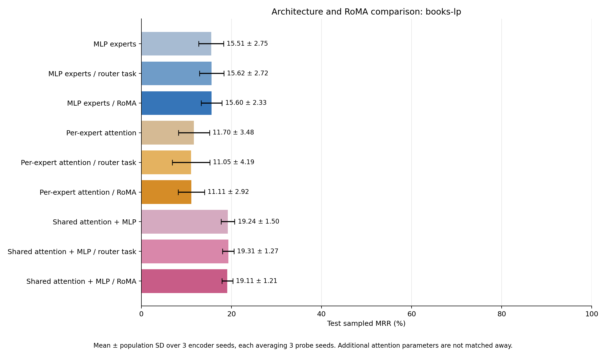
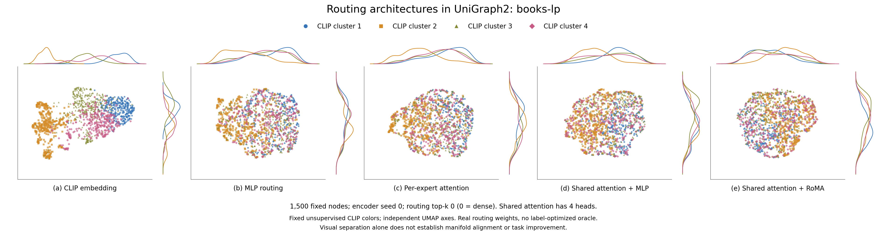

# UniGraph2 architecture comparison: books-lp

Completed nine-condition comparison. Mean ± population SD across 3 encoder seeds, each averaging 3 probe seeds.

| Architecture / stage | Test sampled MRR (%) | Seed means (%) | Slurm jobs |
| --- | ---: | --- | --- |
| MLP experts | 15.51 ± 2.75 | 19.22, 12.62, 14.69 | 84394, 84395, 84396 |
| MLP experts / router task | 15.62 ± 2.72 | 19.46, 13.58, 13.81 | 84394, 84395, 84396 |
| MLP experts / RoMA | 15.60 ± 2.33 | 18.85, 13.48, 14.47 | 84394, 84395, 84396 |
| Per-expert attention | 11.70 ± 3.48 | 7.95, 10.83, 16.33 | 84394, 84395, 84396 |
| Per-expert attention / router task | 11.05 ± 4.19 | 6.47, 10.08, 16.60 | 84394, 84395, 84396 |
| Per-expert attention / RoMA | 11.11 ± 2.92 | 9.26, 8.84, 15.23 | 84394, 84395, 84396 |
| Shared attention + MLP | 19.24 ± 1.50 | 21.33, 17.94, 18.44 | 84394, 84395, 84396 |
| Shared attention + MLP / router task | 19.31 ± 1.27 | 21.10, 18.43, 18.40 | 84394, 84395, 84396 |
| Shared attention + MLP / RoMA | 19.11 ± 1.21 | 20.82, 18.11, 18.40 | 84394, 84395, 84396 |

## Architectures and matched protocol

MLP is the original router → selected feed-forward experts → GAT. Per-expert attention keeps the earlier attention expert implementation. Shared attention applies learned multihead Q/K/V scaled dot-product attention, output projection, residual and LayerNorm before one router and its MLP experts; its GAT backbone is unchanged. Attention operates only on the current graph/subgraph. All layers are unmasked during frozen evaluation.

All cases use source cloth-copurchase, 5 × 32 source updates per domain, lr 0.0001, source-only standardization True, width 1024, 8 experts, and routing top-k 0 (zero means dense). Shared attention has 4 heads. Source and target graphs are disjoint. Architecture comparisons fix these hyperparameters and the budgets; the extra shared-attention parameters are not matched away.

Task-only and RoMA add 3 × 32 gate-only updates per domain at lr 7e-05, each from its own exact baseline checkpoint. Shared attention, experts, GAT, mask token and decoders remain frozen during these stages. RoMA uses source-only reconstruction-quality anchors, λ=0.8, k=5, σ=0.4. Contextual shared-attention teacher routes are averaged over the complete original PPR-pool contexts in which a scored anchor occurs; selected anchors are not treated as a new attention graph.

## Paired effects

| Architecture | RoMA − baseline (points) | RoMA − task-only (points) |
| --- | ---: | ---: | ---: |
| MLP experts | +0.090 ± 0.546 | -0.020 ± 0.522 |
| Per-expert attention | -0.591 ± 1.396 | +0.063 ± 1.934 |
| Shared attention + MLP | -0.129 ± 0.286 | -0.202 ± 0.146 |

## Model parameter counts

| Architecture | Total parameters | Router parameters | Shared heads |
| --- | ---: | ---: | ---: |
| MLP experts | 21021705 | 533512 | — |
| Per-expert attention | 21029897 | 533512 | — |
| Shared attention + MLP | 22073353 | 533512 | 4 |

LP ranks each positive against 100 fixed sampled non-neighbors in the bounded target cohort. Training-edge-only message passing, removal of held-out undirected edges visible in earlier splits, and validation-only head selection prevent direct held-out-edge leakage. Candidates differ from the official full-graph benchmark.

Protocol: `{"candidate_protocol": "fixed sampled non-neighbors within the node cohort; all known positives and self loops excluded", "cohort_counts": {"test": {"eligible_positives": 886, "insufficient_non_neighbors_removed": 0, "negatives_per_positive": 100, "overlap_with_earlier_splits_removed": 228, "selected_positives": 886, "unique_within_cohort": 1114}, "train": {"eligible_positives": 5771, "insufficient_non_neighbors_removed": 0, "negatives_per_positive": 1, "overlap_with_earlier_splits_removed": 0, "selected_positives": 4096, "unique_within_cohort": 5771}, "valid": {"eligible_positives": 327, "insufficient_non_neighbors_removed": 0, "negatives_per_positive": 100, "overlap_with_earlier_splits_removed": 80, "selected_positives": 327, "unique_within_cohort": 407}}, "head": "linear classifier on Hadamard products of unit-normalized frozen embeddings", "nodes": 4096, "official_negative_candidates": false, "official_positive_splits": true, "primary_metric": "mrr", "ranking_ties": "average optimistic and pessimistic rank, as in the MM-Graph evaluator", "split_seed": 1729, "split_sha256": "69aaa100fb80927da221d9aa63359ba7f93297176de867b53e38dd0637659833", "task": "link_prediction", "undirected": true}`.

## Original-space routing diagnostics

Same 1500 nodes and four fixed unsupervised CLIP clusters in every view, from the first declared encoder seed (0). Independent UMAP axes do not establish alignment; kNN overlap is measured before dimensionality reduction. No evaluation labels or label-optimized oracle are used in these plots.

| Case | CLIP kNN overlap@15 | CLIP-cluster silhouette | Mean routing-probability SD | Effective rank |
| --- | ---: | ---: | ---: | ---: |
| mlp-none | 0.0454 | 0.0028 | 0.02419 | 5.66 |
| mlp-task | 0.0437 | -0.0026 | 0.02491 | 5.91 |
| mlp-roma | 0.0471 | 0.0024 | 0.02246 | 6.30 |
| attention-none | 0.0469 | -0.0000 | 0.02408 | 5.94 |
| attention-task | 0.0465 | -0.0037 | 0.02447 | 5.94 |
| attention-roma | 0.0494 | 0.0026 | 0.02229 | 6.35 |
| shared-none | 0.0382 | 0.0022 | 0.01793 | 6.72 |
| shared-task | 0.0388 | 0.0003 | 0.01864 | 6.67 |
| shared-roma | 0.0387 | 0.0004 | 0.01745 | 6.67 |

These bounded transfer experiments do not establish full-dataset or full-paper benchmark performance. Population SD across encoder seeds is observed spread, not a confidence interval or significance test. The RoMA success criterion is a label-free reconstruction surrogate for the paper’s correct-answer criterion.

[All nine routing views](figures/routing-controls.png), [per-probe fractional scores](scores.csv), [complete results and provenance](comparison.json), [plotted routing weights/node IDs/coordinates](figures/manifold-data.npz), [plot settings](figures/visualization.json). PNG, PDF and SVG exports are beside the main figure.
