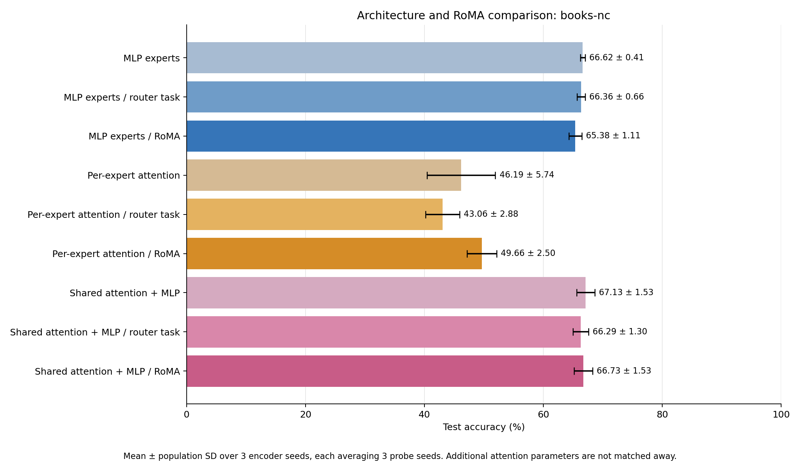
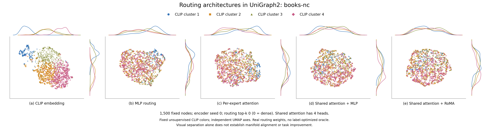

# UniGraph2 architecture comparison: books-nc

Completed nine-condition comparison. Mean ± population SD across 3 encoder seeds, each averaging 3 probe seeds.

| Architecture / stage | Test accuracy (%) | Seed means (%) | Slurm jobs |
| --- | ---: | --- | --- |
| MLP experts | 66.62 ± 0.41 | 66.48, 67.18, 66.21 | 84394, 84395, 84392 |
| MLP experts / router task | 66.36 ± 0.66 | 67.28, 66.05, 65.75 | 84394, 84395, 84392 |
| MLP experts / RoMA | 65.38 ± 1.11 | 66.88, 65.00, 64.25 | 84394, 84395, 84392 |
| Per-expert attention | 46.19 ± 5.74 | 38.43, 52.13, 48.00 | 84394, 84395, 84392 |
| Per-expert attention / router task | 43.06 ± 2.88 | 43.18, 46.53, 39.47 | 84394, 84395, 84392 |
| Per-expert attention / RoMA | 49.66 ± 2.50 | 46.12, 51.30, 51.54 | 84394, 84395, 84392 |
| Shared attention + MLP | 67.13 ± 1.53 | 67.04, 69.05, 65.30 | 84394, 84395, 84392 |
| Shared attention + MLP / router task | 66.29 ± 1.30 | 66.96, 67.44, 64.47 | 84394, 84395, 84392 |
| Shared attention + MLP / RoMA | 66.73 ± 1.53 | 67.15, 68.36, 64.68 | 84394, 84395, 84392 |

## Architectures and matched protocol

MLP is the original router → selected feed-forward experts → GAT. Per-expert attention keeps the earlier attention expert implementation. Shared attention applies learned multihead Q/K/V scaled dot-product attention, output projection, residual and LayerNorm before one router and its MLP experts; its GAT backbone is unchanged. Attention operates only on the current graph/subgraph. All layers are unmasked during frozen evaluation.

All cases use source cloth-copurchase, 5 × 32 source updates per domain, lr 0.0001, source-only standardization True, width 1024, 8 experts, and routing top-k 0 (zero means dense). Shared attention has 4 heads. Source and target graphs are disjoint. Architecture comparisons fix these hyperparameters and the budgets; the extra shared-attention parameters are not matched away.

Task-only and RoMA add 3 × 32 gate-only updates per domain at lr 7e-05, each from its own exact baseline checkpoint. Shared attention, experts, GAT, mask token and decoders remain frozen during these stages. RoMA uses source-only reconstruction-quality anchors, λ=0.8, k=5, σ=0.4. Contextual shared-attention teacher routes are averaged over the complete original PPR-pool contexts in which a scored anchor occurs; selected anchors are not treated as a new attention graph.

## Paired effects

| Architecture | RoMA − baseline (points) | RoMA − task-only (points) |
| --- | ---: | ---: | ---: |
| MLP experts | -1.243 ± 1.166 | -0.983 ± 0.451 |
| Per-expert attention | +3.468 ± 3.482 | +6.597 ± 3.939 |
| Shared attention + MLP | -0.402 ± 0.362 | +0.438 ± 0.335 |

## Model parameter counts

| Architecture | Total parameters | Router parameters | Shared heads |
| --- | ---: | ---: | ---: |
| MLP experts | 21021705 | 533512 | — |
| Per-expert attention | 21029897 | 533512 | — |
| Shared attention + MLP | 22073353 | 533512 | 4 |

## Original-space routing diagnostics

Same 1500 nodes and four fixed unsupervised CLIP clusters in every view, from the first declared encoder seed (0). Independent UMAP axes do not establish alignment; kNN overlap is measured before dimensionality reduction. No evaluation labels or label-optimized oracle are used in these plots.

| Case | CLIP kNN overlap@15 | CLIP-cluster silhouette | Mean routing-probability SD | Effective rank |
| --- | ---: | ---: | ---: | ---: |
| mlp-none | 0.0351 | -0.0120 | 0.02355 | 5.88 |
| mlp-task | 0.0349 | -0.0126 | 0.02435 | 6.04 |
| mlp-roma | 0.0377 | -0.0091 | 0.02195 | 6.46 |
| attention-none | 0.0369 | -0.0076 | 0.02335 | 6.12 |
| attention-task | 0.0356 | -0.0095 | 0.02380 | 6.05 |
| attention-roma | 0.0388 | -0.0057 | 0.02167 | 6.45 |
| shared-none | 0.0367 | -0.0070 | 0.01752 | 6.80 |
| shared-task | 0.0366 | -0.0062 | 0.01817 | 6.75 |
| shared-roma | 0.0363 | -0.0067 | 0.01703 | 6.74 |

These bounded transfer experiments do not establish full-dataset or full-paper benchmark performance. Population SD across encoder seeds is observed spread, not a confidence interval or significance test. The RoMA success criterion is a label-free reconstruction surrogate for the paper’s correct-answer criterion.

[All nine routing views](figures/routing-controls.png), [per-probe fractional scores](scores.csv), [complete results and provenance](comparison.json), [plotted routing weights/node IDs/coordinates](figures/manifold-data.npz), [plot settings](figures/visualization.json). PNG, PDF and SVG exports are beside the main figure.
