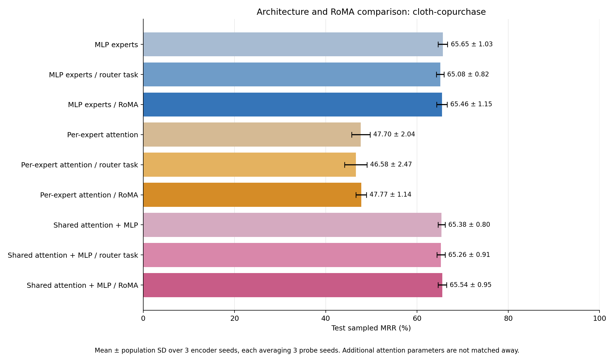
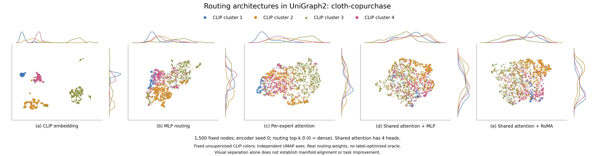

# UniGraph2 architecture comparison: cloth-copurchase

Completed nine-condition comparison. Mean ± population SD across 3 encoder seeds, each averaging 3 probe seeds.

| Architecture / stage | Test sampled MRR (%) | Seed means (%) | Slurm jobs |
| --- | ---: | --- | --- |
| MLP experts | 65.65 ± 1.03 | 65.85, 66.81, 64.30 | 84394, 84395, 84396 |
| MLP experts / router task | 65.08 ± 0.82 | 65.15, 66.05, 64.04 | 84394, 84395, 84396 |
| MLP experts / RoMA | 65.46 ± 1.15 | 65.93, 66.57, 63.87 | 84394, 84395, 84396 |
| Per-expert attention | 47.70 ± 2.04 | 50.51, 45.73, 46.86 | 84394, 84395, 84396 |
| Per-expert attention / router task | 46.58 ± 2.47 | 49.98, 45.59, 44.18 | 84394, 84395, 84396 |
| Per-expert attention / RoMA | 47.77 ± 1.14 | 49.38, 46.95, 46.98 | 84394, 84395, 84396 |
| Shared attention + MLP | 65.38 ± 0.80 | 64.74, 66.51, 64.90 | 84394, 84395, 84396 |
| Shared attention + MLP / router task | 65.26 ± 0.91 | 64.89, 66.51, 64.39 | 84394, 84395, 84396 |
| Shared attention + MLP / RoMA | 65.54 ± 0.95 | 64.62, 66.85, 65.15 | 84394, 84395, 84396 |

## Architectures and matched protocol

MLP is the original router → selected feed-forward experts → GAT. Per-expert attention keeps the earlier attention expert implementation. Shared attention applies learned multihead Q/K/V scaled dot-product attention, output projection, residual and LayerNorm before one router and its MLP experts; its GAT backbone is unchanged. Attention operates only on the current graph/subgraph. All layers are unmasked during frozen evaluation.

All cases use source sports-copurchase, 5 × 32 source updates per domain, lr 0.0001, source-only standardization True, width 1024, 8 experts, and routing top-k 0 (zero means dense). Shared attention has 4 heads. Source and target graphs are disjoint. Architecture comparisons fix these hyperparameters and the budgets; the extra shared-attention parameters are not matched away.

Task-only and RoMA add 3 × 32 gate-only updates per domain at lr 7e-05, each from its own exact baseline checkpoint. Shared attention, experts, GAT, mask token and decoders remain frozen during these stages. RoMA uses source-only reconstruction-quality anchors, λ=0.8, k=5, σ=0.4. Contextual shared-attention teacher routes are averaged over the complete original PPR-pool contexts in which a scored anchor occurs; selected anchors are not treated as a new attention graph.

## Paired effects

| Architecture | RoMA − baseline (points) | RoMA − task-only (points) |
| --- | ---: | ---: | ---: |
| MLP experts | -0.196 ± 0.207 | +0.376 ± 0.396 |
| Per-expert attention | +0.070 ± 0.961 | +1.185 ± 1.397 |
| Shared attention + MLP | +0.160 ± 0.200 | +0.278 ± 0.425 |

## Model parameter counts

| Architecture | Total parameters | Router parameters | Shared heads |
| --- | ---: | ---: | ---: |
| MLP experts | 21021705 | 533512 | — |
| Per-expert attention | 21029897 | 533512 | — |
| Shared attention + MLP | 22073353 | 533512 | 4 |

LP ranks each positive against 100 fixed sampled non-neighbors in the bounded target cohort. Training-edge-only message passing, removal of held-out undirected edges visible in earlier splits, and validation-only head selection prevent direct held-out-edge leakage. Candidates differ from the official full-graph benchmark.

Protocol: `{"candidate_protocol": "fixed sampled non-neighbors within the node cohort; all known positives and self loops excluded", "cohort_counts": {"test": {"eligible_positives": 1798, "insufficient_non_neighbors_removed": 0, "negatives_per_positive": 100, "overlap_with_earlier_splits_removed": 1570, "selected_positives": 1024, "unique_within_cohort": 3368}, "train": {"eligible_positives": 30022, "insufficient_non_neighbors_removed": 0, "negatives_per_positive": 1, "overlap_with_earlier_splits_removed": 0, "selected_positives": 4096, "unique_within_cohort": 30022}, "valid": {"eligible_positives": 2430, "insufficient_non_neighbors_removed": 0, "negatives_per_positive": 100, "overlap_with_earlier_splits_removed": 1337, "selected_positives": 1024, "unique_within_cohort": 3767}}, "head": "linear classifier on Hadamard products of unit-normalized frozen embeddings", "nodes": 4096, "official_negative_candidates": false, "official_positive_splits": true, "primary_metric": "mrr", "ranking_ties": "average optimistic and pessimistic rank, as in the MM-Graph evaluator", "split_seed": 1729, "split_sha256": "491a9c29db1855f525d24e3b25aaeb3e5af6e99a714051452b99d120c8875238", "task": "link_prediction", "undirected": true}`.

## Original-space routing diagnostics

Same 1500 nodes and four fixed unsupervised CLIP clusters in every view, from the first declared encoder seed (0). Independent UMAP axes do not establish alignment; kNN overlap is measured before dimensionality reduction. No evaluation labels or label-optimized oracle are used in these plots.

| Case | CLIP kNN overlap@15 | CLIP-cluster silhouette | Mean routing-probability SD | Effective rank |
| --- | ---: | ---: | ---: | ---: |
| mlp-none | 0.1930 | 0.0684 | 0.02720 | 5.51 |
| mlp-task | 0.1962 | 0.0776 | 0.03285 | 4.37 |
| mlp-roma | 0.1922 | 0.0611 | 0.02398 | 5.30 |
| attention-none | 0.1733 | 0.0848 | 0.02479 | 6.11 |
| attention-task | 0.1845 | 0.1339 | 0.02933 | 4.78 |
| attention-roma | 0.1699 | 0.0878 | 0.02032 | 6.21 |
| shared-none | 0.1447 | 0.0139 | 0.01921 | 6.41 |
| shared-task | 0.1561 | 0.0324 | 0.02051 | 6.33 |
| shared-roma | 0.1560 | 0.0321 | 0.01829 | 6.23 |

These bounded transfer experiments do not establish full-dataset or full-paper benchmark performance. Population SD across encoder seeds is observed spread, not a confidence interval or significance test. The RoMA success criterion is a label-free reconstruction surrogate for the paper’s correct-answer criterion.

[All nine routing views](figures/routing-controls.png), [per-probe fractional scores](scores.csv), [complete results and provenance](comparison.json), [plotted routing weights/node IDs/coordinates](figures/manifold-data.npz), [plot settings](figures/visualization.json). PNG, PDF and SVG exports are beside the main figure.
