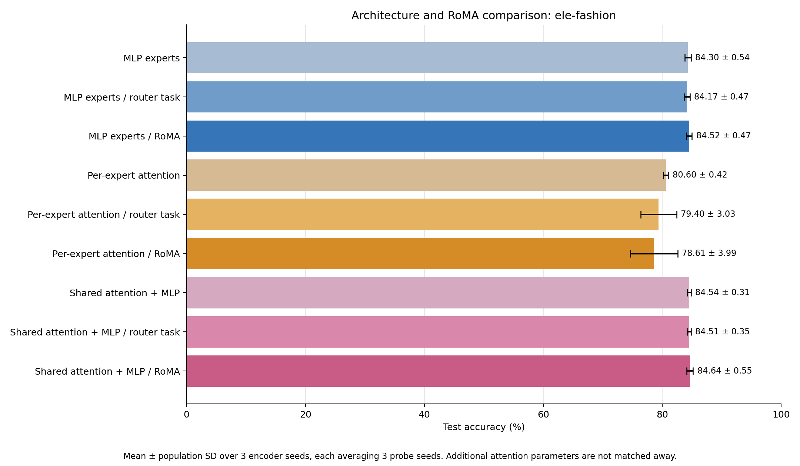
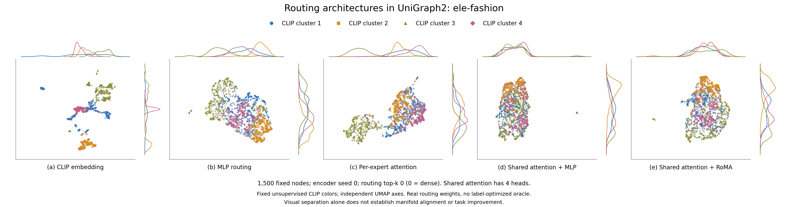

# UniGraph2 architecture comparison: ele-fashion

Completed nine-condition comparison. Mean ± population SD across 3 encoder seeds, each averaging 3 probe seeds.

| Architecture / stage | Test accuracy (%) | Seed means (%) | Slurm jobs |
| --- | ---: | --- | --- |
| MLP experts | 84.30 ± 0.54 | 83.77, 84.10, 85.05 | 84394, 84395, 84392 |
| MLP experts / router task | 84.17 ± 0.47 | 83.74, 83.93, 84.83 | 84394, 84395, 84392 |
| MLP experts / RoMA | 84.52 ± 0.47 | 84.18, 84.18, 85.19 | 84394, 84395, 84392 |
| Per-expert attention | 80.60 ± 0.42 | 80.84, 80.95, 80.00 | 84394, 84395, 84392 |
| Per-expert attention / router task | 79.40 ± 3.03 | 81.34, 81.73, 75.12 | 84394, 84395, 84392 |
| Per-expert attention / RoMA | 78.61 ± 3.99 | 81.26, 81.59, 72.97 | 84394, 84395, 84392 |
| Shared attention + MLP | 84.54 ± 0.31 | 84.88, 84.13, 84.60 | 84394, 84395, 84392 |
| Shared attention + MLP / router task | 84.51 ± 0.35 | 84.74, 84.02, 84.77 | 84394, 84395, 84392 |
| Shared attention + MLP / RoMA | 84.64 ± 0.55 | 84.55, 84.02, 85.36 | 84394, 84395, 84392 |

## Architectures and matched protocol

MLP is the original router → selected feed-forward experts → GAT. Per-expert attention keeps the earlier attention expert implementation. Shared attention applies learned multihead Q/K/V scaled dot-product attention, output projection, residual and LayerNorm before one router and its MLP experts; its GAT backbone is unchanged. Attention operates only on the current graph/subgraph. All layers are unmasked during frozen evaluation.

All cases use source cloth-copurchase, 5 × 32 source updates per domain, lr 0.0001, source-only standardization True, width 1024, 8 experts, and routing top-k 0 (zero means dense). Shared attention has 4 heads. Source and target graphs are disjoint. Architecture comparisons fix these hyperparameters and the budgets; the extra shared-attention parameters are not matched away.

Task-only and RoMA add 3 × 32 gate-only updates per domain at lr 7e-05, each from its own exact baseline checkpoint. Shared attention, experts, GAT, mask token and decoders remain frozen during these stages. RoMA uses source-only reconstruction-quality anchors, λ=0.8, k=5, σ=0.4. Contextual shared-attention teacher routes are averaged over the complete original PPR-pool contexts in which a scored anchor occurs; selected anchors are not treated as a new attention graph.

## Paired effects

| Architecture | RoMA − baseline (points) | RoMA − task-only (points) |
| --- | ---: | ---: | ---: |
| MLP experts | +0.214 ± 0.146 | +0.353 ± 0.080 |
| Per-expert attention | -1.990 ± 3.565 | -0.790 ± 0.960 |
| Shared attention + MLP | +0.102 ± 0.469 | +0.130 ± 0.332 |

## Model parameter counts

| Architecture | Total parameters | Router parameters | Shared heads |
| --- | ---: | ---: | ---: |
| MLP experts | 21021705 | 533512 | — |
| Per-expert attention | 21029897 | 533512 | — |
| Shared attention + MLP | 22073353 | 533512 | 4 |

## Original-space routing diagnostics

Same 1500 nodes and four fixed unsupervised CLIP clusters in every view, from the first declared encoder seed (0). Independent UMAP axes do not establish alignment; kNN overlap is measured before dimensionality reduction. No evaluation labels or label-optimized oracle are used in these plots.

| Case | CLIP kNN overlap@15 | CLIP-cluster silhouette | Mean routing-probability SD | Effective rank |
| --- | ---: | ---: | ---: | ---: |
| mlp-none | 0.1797 | 0.0795 | 0.02642 | 6.18 |
| mlp-task | 0.2207 | 0.2075 | 0.04311 | 3.75 |
| mlp-roma | 0.1861 | 0.0634 | 0.02409 | 5.99 |
| attention-none | 0.1800 | 0.1128 | 0.02722 | 5.80 |
| attention-task | 0.1868 | 0.1188 | 0.03522 | 4.36 |
| attention-roma | 0.1845 | 0.1148 | 0.02453 | 5.44 |
| shared-none | 0.1172 | -0.0010 | 0.02081 | 6.49 |
| shared-task | 0.1308 | -0.0176 | 0.02262 | 6.43 |
| shared-roma | 0.1344 | 0.0281 | 0.02060 | 6.23 |

These bounded transfer experiments do not establish full-dataset or full-paper benchmark performance. Population SD across encoder seeds is observed spread, not a confidence interval or significance test. The RoMA success criterion is a label-free reconstruction surrogate for the paper’s correct-answer criterion.

[All nine routing views](figures/routing-controls.png), [per-probe fractional scores](scores.csv), [complete results and provenance](comparison.json), [plotted routing weights/node IDs/coordinates](figures/manifold-data.npz), [plot settings](figures/visualization.json). PNG, PDF and SVG exports are beside the main figure.
