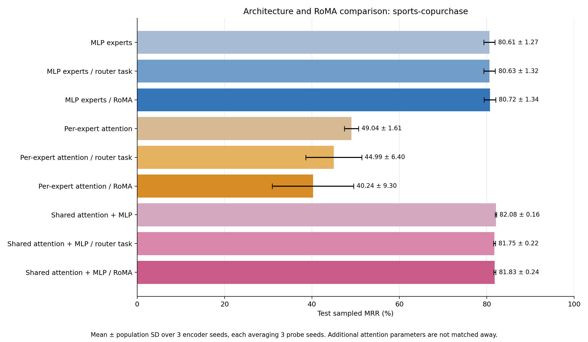
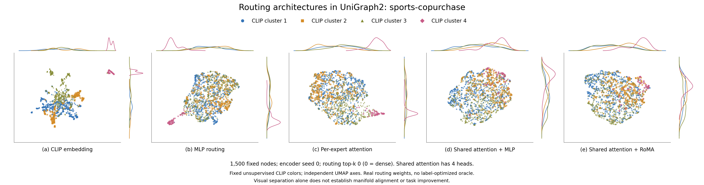

# UniGraph2 architecture comparison: sports-copurchase

Completed nine-condition comparison. Mean ± population SD across 3 encoder seeds, each averaging 3 probe seeds.

| Architecture / stage | Test sampled MRR (%) | Seed means (%) | Slurm jobs |
| --- | ---: | --- | --- |
| MLP experts | 80.61 ± 1.27 | 81.90, 78.88, 81.05 | 84394, 84395, 84392 |
| MLP experts / router task | 80.63 ± 1.32 | 81.80, 78.79, 81.29 | 84394, 84395, 84392 |
| MLP experts / RoMA | 80.72 ± 1.34 | 81.82, 78.84, 81.51 | 84394, 84395, 84392 |
| Per-expert attention | 49.04 ± 1.61 | 51.02, 47.08, 49.02 | 84394, 84395, 84392 |
| Per-expert attention / router task | 44.99 ± 6.40 | 50.26, 35.99, 48.73 | 84394, 84395, 84392 |
| Per-expert attention / RoMA | 40.24 ± 9.30 | 27.40, 44.19, 49.13 | 84394, 84395, 84392 |
| Shared attention + MLP | 82.08 ± 0.16 | 82.25, 82.13, 81.86 | 84394, 84395, 84392 |
| Shared attention + MLP / router task | 81.75 ± 0.22 | 81.59, 82.05, 81.59 | 84394, 84395, 84392 |
| Shared attention + MLP / RoMA | 81.83 ± 0.24 | 81.56, 82.15, 81.77 | 84394, 84395, 84392 |

## Architectures and matched protocol

MLP is the original router → selected feed-forward experts → GAT. Per-expert attention keeps the earlier attention expert implementation. Shared attention applies learned multihead Q/K/V scaled dot-product attention, output projection, residual and LayerNorm before one router and its MLP experts; its GAT backbone is unchanged. Attention operates only on the current graph/subgraph. All layers are unmasked during frozen evaluation.

All cases use source cloth-copurchase, 5 × 32 source updates per domain, lr 0.0001, source-only standardization True, width 1024, 8 experts, and routing top-k 0 (zero means dense). Shared attention has 4 heads. Source and target graphs are disjoint. Architecture comparisons fix these hyperparameters and the budgets; the extra shared-attention parameters are not matched away.

Task-only and RoMA add 3 × 32 gate-only updates per domain at lr 7e-05, each from its own exact baseline checkpoint. Shared attention, experts, GAT, mask token and decoders remain frozen during these stages. RoMA uses source-only reconstruction-quality anchors, λ=0.8, k=5, σ=0.4. Contextual shared-attention teacher routes are averaged over the complete original PPR-pool contexts in which a scored anchor occurs; selected anchors are not treated as a new attention graph.

## Paired effects

| Architecture | RoMA − baseline (points) | RoMA − task-only (points) |
| --- | ---: | ---: | ---: |
| MLP experts | +0.116 ± 0.242 | +0.095 ± 0.085 |
| Per-expert attention | -8.800 ± 10.551 | -4.755 ± 13.192 |
| Shared attention + MLP | -0.253 ± 0.312 | +0.081 ± 0.086 |

## Model parameter counts

| Architecture | Total parameters | Router parameters | Shared heads |
| --- | ---: | ---: | ---: |
| MLP experts | 21021705 | 533512 | — |
| Per-expert attention | 21029897 | 533512 | — |
| Shared attention + MLP | 22073353 | 533512 | 4 |

LP ranks each positive against 100 fixed sampled non-neighbors in the bounded target cohort. Training-edge-only message passing, removal of held-out undirected edges visible in earlier splits, and validation-only head selection prevent direct held-out-edge leakage. Candidates differ from the official full-graph benchmark.

Protocol: `{"candidate_protocol": "fixed sampled non-neighbors within the node cohort; all known positives and self loops excluded", "cohort_counts": {"test": {"eligible_positives": 1083, "insufficient_non_neighbors_removed": 0, "negatives_per_positive": 100, "overlap_with_earlier_splits_removed": 1072, "selected_positives": 1024, "unique_within_cohort": 2155}, "train": {"eligible_positives": 20728, "insufficient_non_neighbors_removed": 0, "negatives_per_positive": 1, "overlap_with_earlier_splits_removed": 0, "selected_positives": 4096, "unique_within_cohort": 20728}, "valid": {"eligible_positives": 1521, "insufficient_non_neighbors_removed": 0, "negatives_per_positive": 100, "overlap_with_earlier_splits_removed": 961, "selected_positives": 1024, "unique_within_cohort": 2482}}, "head": "linear classifier on Hadamard products of unit-normalized frozen embeddings", "nodes": 4096, "official_negative_candidates": false, "official_positive_splits": true, "primary_metric": "mrr", "ranking_ties": "average optimistic and pessimistic rank, as in the MM-Graph evaluator", "split_seed": 1729, "split_sha256": "631e8c2a700758b5c1cdc468b4a0bfe649e0d67b1472f974ec5fb7942f15d779", "task": "link_prediction", "undirected": true}`.

## Original-space routing diagnostics

Same 1500 nodes and four fixed unsupervised CLIP clusters in every view, from the first declared encoder seed (0). Independent UMAP axes do not establish alignment; kNN overlap is measured before dimensionality reduction. No evaluation labels or label-optimized oracle are used in these plots.

| Case | CLIP kNN overlap@15 | CLIP-cluster silhouette | Mean routing-probability SD | Effective rank |
| --- | ---: | ---: | ---: | ---: |
| mlp-none | 0.1098 | 0.0109 | 0.02610 | 6.16 |
| mlp-task | 0.1180 | 0.0157 | 0.02991 | 6.04 |
| mlp-roma | 0.1104 | 0.0162 | 0.02339 | 6.33 |
| attention-none | 0.1111 | 0.0121 | 0.02568 | 6.40 |
| attention-task | 0.1182 | 0.0188 | 0.02861 | 6.12 |
| attention-roma | 0.1093 | 0.0154 | 0.02239 | 6.50 |
| shared-none | 0.0860 | -0.0281 | 0.02049 | 6.63 |
| shared-task | 0.0885 | -0.0116 | 0.02163 | 6.73 |
| shared-roma | 0.0889 | -0.0180 | 0.01980 | 6.53 |

These bounded transfer experiments do not establish full-dataset or full-paper benchmark performance. Population SD across encoder seeds is observed spread, not a confidence interval or significance test. The RoMA success criterion is a label-free reconstruction surrogate for the paper’s correct-answer criterion.

[All nine routing views](figures/routing-controls.png), [per-probe fractional scores](scores.csv), [complete results and provenance](comparison.json), [plotted routing weights/node IDs/coordinates](figures/manifold-data.npz), [plot settings](figures/visualization.json). PNG, PDF and SVG exports are beside the main figure.
